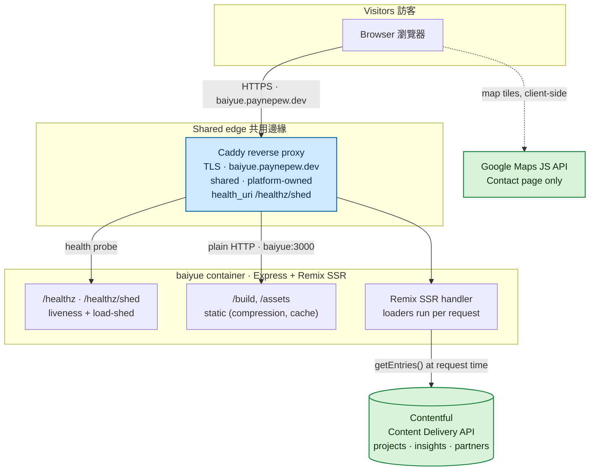

# 百越工程 · baiyue

**English** · [繁體中文](#繁體中文)

[](https://baiyue.paynepew.dev)


The server-rendered corporate site for **百越工程資訊有限公司** (Baiyue Information
Co., Ltd.), a Taiwanese **BIM** (Building Information Modeling) engineering
consultancy. It showcases the firm's services, project portfolio, and articles —
all authored in a headless CMS, so the marketing team edits content without a
redeploy.

Its tagline sets the tone: **能讓 BIM 引以為傲的工程才是真實的 BIM** — *"engineering
that BIM can be proud of is what real BIM is."*

**Live at [baiyue.paynepew.dev](https://baiyue.paynepew.dev).** The site is fully
server-rendered Traditional Chinese, self-hosted on a shared VPS behind a shared,
platform-owned edge proxy — moved off Netlify onto that box as one containerized
tenant.

## What it is

A [Remix](https://remix.run/) SSR app on React 18. Every route has a server
loader that pulls its content from **Contentful** at request time, so pages
arrive fully rendered (good for SEO and first paint) and non-developers own the
copy. The three content-driven surfaces — **工程實績 (Projects)**, **百越觀點
(Insights)**, and homepage **partners** — are all Contentful entries; the code
only owns layout, animation, and the category taxonomy.

The interesting engineering is in how it *runs*. The site was migrated off
Netlify Functions onto a small, shared Ubuntu box. That meant swapping the
serverless handler for a custom Express server that adds the two things a
single-process tenant on a tight box needs: a liveness probe and a **load-shed**
signal driven by an in-flight request cap. It ships as a ~40 MB-idle Docker
container, deployed by image-pull from GHCR on every push to `main`.

## Pages

| Route | Page | Content source |
|---|---|---|
| `/` | Landing — hero (logo video), opening video, about teaser, featured projects, partners, contact | Contentful (`projects`, `partners`) |
| `/about` | 關於百越 — company philosophy, service carousel, the 10-service grid | static |
| `/projects` · `/projects/:category` · `/projects/:category/:project` | 工程實績 — portfolio, filterable by category, with per-project detail pages | Contentful (`projects`) |
| `/insights` · `/insights/:id` | 百越觀點 — BIM articles with rich-text bodies | Contentful (`insights`) |
| `/contact` | 聯絡我們 — Google Map + address, phone, email | static |

**Project categories:** 住宅 (residence) · 辦公 (office) · 教育 (education) · 工業
(industry) · 停車場 (parking) · 營區 (military) · 其他 (others).

**Services (the `/about` grid):** BIM modeling (architecture / structure / MEP),
shop drawings, rendering & animation, quantity takeoff, clash-detection review,
enterprise BIM adoption, BIM consulting, component authoring, BIM training, and
GREEN BIM.

## Architecture

The whole app — the Remix SSR handler, static assets, and the health endpoints —
is **one container behind a shared, platform-owned Caddy** that terminates TLS
for `baiyue.paynepew.dev`. There is no database: content lives in Contentful and
is fetched server-side per request; the Google Map is the only client-side
third-party call.



**Request flow.** A request reaches the container through the edge Caddy. Static
files under `/build` (fingerprinted, cached hard) and `/public` are served
directly by Express; everything else hits the Remix handler, whose route loaders
call Contentful and return a fully rendered HTML page. `/healthz` and
`/healthz/shed` are declared *before* the in-flight counter middleware, so they
are never shed and never counted.

**Load shedding.** baiyue runs as a single Node process, so it caps its own
concurrency: an in-flight gauge tracks live SSR requests, and `/healthz/shed`
returns **503** once it reaches `BAIYUE_MAX_INFLIGHT` (default 32). The edge
Caddy uses that endpoint as its health check and drops traffic at the edge when
the box is saturated, instead of letting the process thrash.

**Delivery.** GitHub Actions builds the Docker image, pushes it to GHCR, then
SSHes to the box to `docker compose pull && up` and smoke-test `/healthz` from
inside the container. No source tree lives on the box — only the compose file and
`.env.prod`.

## Tech stack

| Layer | Choice | Notes |
|---|---|---|
| Framework | **Remix 1.12** (SSR) on **React 18** + **TypeScript** | Per-route server loaders; content is fetched server-side so pages arrive rendered and indexable. |
| Content | **Contentful** (headless CMS) via the `contentful` SDK | `projects`, `insights`, and `partners` are authored in Contentful and pulled at request time — editors change content with no redeploy. |
| Rich text | `@contentful/rich-text-react-renderer` | Renders Contentful rich-text documents (project / insight bodies) to React. |
| Styling | **Tailwind CSS 3** + **PostCSS**, custom design tokens | Gold-on-iron dark theme (`primary #E5AE00`); PostCSS compiles `styles/` → `app/styles/app.css`, linked as a stylesheet. |
| Animation | **Framer Motion** | Page-transition fade in `root.tsx`, plus in-view scroll reveals across sections. |
| Maps | `@vis.gl/react-google-maps` | Google Map + marker on the Contact page (client-side). |
| Server | Custom **Express** (`@remix-run/express`) + `compression` + `morgan` | Replaces the old Netlify handler; adds `/healthz`, `/healthz/shed`, and an in-flight concurrency cap. |
| Runtime | **Node 20 LTS** | Pinned to 20 — Remix 1.12 is not validated on Node 24. |
| Container | **Docker** multi-stage, non-root | build → `npm prune --omit=dev` → slim runtime; V8 heap capped at 256 MB to stay small on a shared box. |
| Delivery | **GitHub Actions → GHCR → SSH** image-pull to the VPS | Every push to `main` builds, pushes, rolls the container, and smoke-tests `/healthz`. |

## Quick start

You need **Node 20**, and a **Contentful** space (space id + Content Delivery
access token) — the Projects, Insights, and Partners content is fetched from
Contentful at request time, so those pages need real credentials to render.

```bash
# 1. Clone
git clone https://github.com/PaynePew/baiyue.git
cd baiyue

# 2. Install
npm install

# 3. Configure
cp .env.example .env        # then set CONTENTFUL_SPACE_ID and CONTENTFUL_ACCESS_TOKEN

# 4. Dev (Remix + Tailwind watcher, concurrently)
npm run dev                 # http://localhost:3000
```

Production build and serve (the same path the container runs):

```bash
npm run build               # build:css (PostCSS) + remix build → build/index.js
npm start                   # NODE_ENV=production node server.js
```

Or run the exact production image locally:

```bash
docker build -t baiyue .
docker run --rm -p 3000:3000 --env-file .env baiyue
curl localhost:3000/healthz        # {"status":"ok"}
```

> **Environment.** `CONTENTFUL_SPACE_ID` and `CONTENTFUL_ACCESS_TOKEN` are
> required. `BAIYUE_MAX_INFLIGHT` (default 32) tunes the load-shed threshold.
> `REACT_APP_GOOGLEMAP_API_KEY` is listed for the follow-up that moves the map
> key to env; see [Known tradeoffs](#known-tradeoffs). Full list in
> [`.env.example`](.env.example).

## Project structure

```
baiyue/
├── app/
│   ├── root.tsx              # HTML document, <Meta>/OG tags, header, page-transition wrapper, ErrorBoundary
│   ├── entry.client.tsx      # Remix client/server entries
│   ├── entry.server.tsx
│   ├── contentful.server.js  # Contentful Delivery API client (server-only)
│   ├── routes/               # File routes: index, about, contact, projects/*, insights/*
│   ├── pages/                # Page bodies: LandingPage, AboutPage, ProjectPage, InsightsPage, ContactPage, ErrorPage
│   ├── components/           # Shared UI: Header, Footer, OpVideo
│   ├── hooks/                # useScrollListener
│   ├── types/                # Contentful content-model types: Project, Insight, Partner
│   ├── utils/                # helpers
│   └── styles/               # Tailwind entry + compiled app.css
├── public/                   # Static assets, favicons, sitemap.xml, /assets media (logo video, imagery)
├── styles/                   # PostCSS source, compiled into app/styles
├── server.js                 # Custom Express SSR server + /healthz + /healthz/shed + in-flight cap
├── Dockerfile                # Node 20 multi-stage (build → prune → slim runtime, non-root)
├── docker-compose.prod.yml   # Tenant compose: joins external `edge` net, mem_limit, healthcheck
├── .github/workflows/deploy.yml   # CD: build → GHCR → ssh box → compose pull/up → /healthz smoke
├── DEPLOY.md                 # VPS migration notes (off Netlify → shared box)
├── remix.config.js · tailwind.config.js · postcss.config.js
└── netlify.toml              # Legacy pre-migration config, retained for reference
```

## Deployment

The live site is **tenant #4** on a shared Ubuntu box (`box.paynepew.dev`, 2
vCPU / 2 GB), reached only through the platform's shared edge Caddy — no host
ports are published. The container joins an external `edge` Docker network under
the service name `baiyue`, which is exactly what Caddy reverse-proxies to
(`baiyue:3000`).

- **Image-pull CD.** `deploy.yml` builds on every push to `main`, pushes
  `ghcr.io/paynepew/baiyue:latest` (+ the commit SHA) to GHCR, ships only
  `docker-compose.prod.yml` to `/opt/baiyue/`, then rolls the container and
  smoke-tests `/healthz` inside it.
- **Footprint.** Measured ~32 MiB idle / ~66 MiB peak, so it fits the tight box
  with `mem_limit: 256m` and `cpus: "0.5"`; `NODE_OPTIONS=--max-old-space-size=256`
  caps the V8 heap.
- **Health contract.** The container exposes `/healthz` (liveness) and
  `/healthz/shed` (load-shed); the platform wires `health_uri=/healthz/shed` so
  the edge sheds baiyue traffic when it saturates.

Migration details — what changed from the Netlify build, the verification log,
and the owner-only secret steps — are in [`DEPLOY.md`](DEPLOY.md).

## Known tradeoffs

- **The Google Maps key is currently hardcoded** in
  `app/pages/ContactPage/index.tsx`. It is a client-side JS API key (inherently
  public and already in git history), so moving it to an env var would not make
  it secret. The real control is the Google-side **referrer restriction** to the
  live domain, which is the cost backstop. Wiring it through the root loader to
  `window.ENV` is a follow-up, not a security fix.
- **`public/admin/`** is a non-functional Decap-CMS demo remnant, retained for
  now; content is authored in Contentful, not there.
- **A fresh clone needs Contentful credentials** to render the CMS-driven pages —
  unlike a static-content site, there is no committed fixture data.

---

# 繁體中文

[English](#百越工程--baiyue) · **繁體中文**

[](https://baiyue.paynepew.dev)


**百越工程資訊有限公司**的官方網站——一家台灣的 **BIM**（建築資訊模型）工程顧問公司。
網站以伺服器端渲染（SSR）呈現公司的服務項目、工程實績與觀點文章,內容全部在 headless
CMS 上撰寫,行銷團隊改內容不必重新部署。

它的標語定了調:**能讓 BIM 引以為傲的工程才是真實的 BIM**。

**線上版:[baiyue.paynepew.dev](https://baiyue.paynepew.dev)。** 全站為伺服器端渲染的
繁體中文,自行托管在一台共享 VPS 上、掛在平台層擁有的共用邊緣代理後面——從 Netlify 搬
到那台機器上,成為一個容器化的租戶。

## 這是什麼

一個跑在 React 18 上的 [Remix](https://remix.run/) SSR 應用。每條路由都有一個伺服器
loader,在請求當下從 **Contentful** 拉取內容,所以頁面送達時已完整渲染(對 SEO 與首屏
有利),而內容由非工程人員掌握。三個由內容驅動的區塊——**工程實績**、**百越觀點**、以及
首頁的**合作夥伴**——全都是 Contentful 的 entry;程式碼只負責版面、動畫與分類。

真正有意思的工程在它**怎麼跑**。網站從 Netlify Functions 搬到一台小型共享 Ubuntu 機器
上,這代表要把 serverless handler 換成一個自訂的 Express 伺服器,補上一台吃緊機器上的
單行程租戶所需的兩件事:一個 liveness 探針,以及一個由**在途請求上限**驅動的**載荷卸除
(load-shed)** 訊號。它以一個閒置約 40 MB 的 Docker 容器出貨,每次 push 到 `main` 就以
image-pull 的方式從 GHCR 部署。

## 頁面

| 路由 | 頁面 | 內容來源 |
|---|---|---|
| `/` | 首頁 — hero（logo 影片）、開場影片、關於百越導引、精選實績、合作夥伴、聯絡 | Contentful（`projects`、`partners`）|
| `/about` | 關於百越 — 公司理念、服務輪播、10 項服務網格 | 靜態 |
| `/projects` · `/projects/:category` · `/projects/:category/:project` | 工程實績 — 依類別篩選的作品集,附各案例詳情頁 | Contentful（`projects`）|
| `/insights` · `/insights/:id` | 百越觀點 — 帶 rich-text 內文的 BIM 文章 | Contentful（`insights`）|
| `/contact` | 聯絡我們 — Google 地圖 + 地址、電話、Email | 靜態 |

**實績分類:** 住宅 · 辦公 · 教育 · 工業 · 停車場 · 營區 · 其他。

**服務項目（`/about` 網格）:** 建築／結構／機電 BIM 建模、施工圖、渲染與動畫、算量、
工程整合檢討（碰撞檢查）、BIM 企業導用、BIM 顧問、元件建置、BIM 教育訓練、GREEN BIM。

## 系統架構

整個 app——Remix SSR handler、靜態資產、以及健康端點——是**共用、平台層擁有的 Caddy
後面的同一個容器**,由 Caddy 為 `baiyue.paynepew.dev` 卸載 TLS。沒有資料庫:內容放在
Contentful、每個請求在伺服器端拉取;Google 地圖是唯一的前端第三方呼叫。


**請求流程。** 請求經邊緣 Caddy 到達容器。`/build` 下的靜態檔（帶指紋、快取夠久）與
`/public` 由 Express 直接服務;其餘全部進 Remix handler,由它的路由 loader 呼叫
Contentful 並回傳完整渲染的 HTML。`/healthz` 與 `/healthz/shed` 宣告在在途計數
middleware **之前**,所以永遠不會被卸除、也不會被計數。

**載荷卸除。** baiyue 是單一 Node 行程,所以它自己限制併發:一個在途計量器追蹤活躍的
SSR 請求,一旦達到 `BAIYUE_MAX_INFLIGHT`（預設 32),`/healthz/shed` 就回 **503**。邊緣
Caddy 把這個端點當健康檢查,機器飽和時就在邊緣端丟棄流量,而不是讓行程空轉抖動。

**交付。** GitHub Actions 建 Docker image、推上 GHCR,再 SSH 進機器 `docker compose
pull && up`,並從容器內部 smoke-test `/healthz`。機器上沒有原始碼——只有 compose 檔與
`.env.prod`。

## 技術棧

| 層 | 選用 | 說明 |
|---|---|---|
| 框架 | **Remix 1.12**（SSR）+ **React 18** + **TypeScript** | 逐路由的伺服器 loader;內容在伺服器端取得,頁面送達即已渲染、可被索引。 |
| 內容 | **Contentful**（headless CMS),經 `contentful` SDK | `projects`、`insights`、`partners` 在 Contentful 撰寫,請求當下拉取——編輯改內容不必重新部署。 |
| 富文本 | `@contentful/rich-text-react-renderer` | 把 Contentful 的 rich-text 文件（案例／文章內文)渲染成 React。 |
| 樣式 | **Tailwind CSS 3** + **PostCSS**,自訂設計 token | 金色配鐵灰的深色主題（`primary #E5AE00`);PostCSS 把 `styles/` 編譯成 `app/styles/app.css`,以 stylesheet 連入。 |
| 動畫 | **Framer Motion** | `root.tsx` 的換頁淡入,以及各區塊的進場捲動動畫。 |
| 地圖 | `@vis.gl/react-google-maps` | 聯絡頁的 Google 地圖與標記(前端)。 |
| 伺服器 | 自訂 **Express**（`@remix-run/express`）+ `compression` + `morgan` | 取代舊的 Netlify handler;加上 `/healthz`、`/healthz/shed` 與在途併發上限。 |
| Runtime | **Node 20 LTS** | 釘死在 20——Remix 1.12 未在 Node 24 上驗證。 |
| 容器 | **Docker** 多階段、非 root | build → `npm prune --omit=dev` → 精簡 runtime;V8 heap 上限 256 MB,在共享機器上保持精巧。 |
| 交付 | **GitHub Actions → GHCR → SSH** image-pull 到 VPS | 每次 push 到 `main` 都重建、推送、滾動容器,並 smoke-test `/healthz`。 |

## 快速上手

需要 **Node 20**,以及一個 **Contentful** space(space id + Content Delivery access
token)——工程實績、觀點、合作夥伴的內容是在請求當下從 Contentful 拉取的,所以這些頁面
要有真實憑證才能渲染。

```bash
# 1. Clone
git clone https://github.com/PaynePew/baiyue.git
cd baiyue

# 2. 安裝
npm install

# 3. 設定
cp .env.example .env        # 填入 CONTENTFUL_SPACE_ID 與 CONTENTFUL_ACCESS_TOKEN

# 4. 開發（Remix + Tailwind watcher,concurrently 一起跑）
npm run dev                 # http://localhost:3000
```

正式建置與啟動(與容器內走的是同一條路):

```bash
npm run build               # build:css（PostCSS）+ remix build → build/index.js
npm start                   # NODE_ENV=production node server.js
```

或在本機跑與正式環境一模一樣的映像:

```bash
docker build -t baiyue .
docker run --rm -p 3000:3000 --env-file .env baiyue
curl localhost:3000/healthz        # {"status":"ok"}
```

> **環境變數。** `CONTENTFUL_SPACE_ID` 與 `CONTENTFUL_ACCESS_TOKEN` 為必填。
> `BAIYUE_MAX_INFLIGHT`（預設 32)調整載荷卸除門檻。`REACT_APP_GOOGLEMAP_API_KEY`
> 是為「把地圖金鑰移到 env」這個後續工作預留的,見[已知取捨](#已知取捨)。完整清單見
> [`.env.example`](.env.example)。

## 專案結構

```
baiyue/
├── app/
│   ├── root.tsx              # HTML 文件、<Meta>/OG 標籤、header、換頁動畫外層、ErrorBoundary
│   ├── entry.client.tsx      # Remix client/server 進入點
│   ├── entry.server.tsx
│   ├── contentful.server.js  # Contentful Delivery API client(僅伺服器端)
│   ├── routes/               # 檔案路由:index、about、contact、projects/*、insights/*
│   ├── pages/                # 頁面主體:LandingPage、AboutPage、ProjectPage、InsightsPage、ContactPage、ErrorPage
│   ├── components/           # 共用 UI:Header、Footer、OpVideo
│   ├── hooks/                # useScrollListener
│   ├── types/                # Contentful 內容模型型別:Project、Insight、Partner
│   ├── utils/                # helpers
│   └── styles/               # Tailwind 進入點 + 編譯後的 app.css
├── public/                   # 靜態資產、favicon、sitemap.xml、/assets 媒體(logo 影片、圖像)
├── styles/                   # PostCSS 原始碼,編譯進 app/styles
├── server.js                 # 自訂 Express SSR 伺服器 + /healthz + /healthz/shed + 在途上限
├── Dockerfile                # Node 20 多階段(build → prune → 精簡 runtime、非 root)
├── docker-compose.prod.yml   # 租戶 compose:加入外部 `edge` 網路、mem_limit、healthcheck
├── .github/workflows/deploy.yml   # CD:build → GHCR → ssh box → compose pull/up → /healthz smoke
├── DEPLOY.md                 # VPS 遷移筆記(從 Netlify → 共享機器)
├── remix.config.js · tailwind.config.js · postcss.config.js
└── netlify.toml              # 遷移前的舊設定,保留備查
```

## 部署

線上網站是一台共享 Ubuntu 機器（`box.paynepew.dev`,2 vCPU / 2 GB)上的**第 4 個租戶**,
只透過平台的共用邊緣 Caddy 對外——不發布任何 host port。容器以服務名 `baiyue` 加入外部
`edge` Docker 網路,而這正是 Caddy 反向代理的目標（`baiyue:3000`)。

- **Image-pull CD。** `deploy.yml` 在每次 push 到 `main` 時建置,把
  `ghcr.io/paynepew/baiyue:latest`（加上 commit SHA)推上 GHCR,只把
  `docker-compose.prod.yml` 送到 `/opt/baiyue/`,再滾動容器並在其內部 smoke-test
  `/healthz`。
- **佔用。** 實測約 32 MiB idle / 66 MiB peak,所以塞得進吃緊的機器:`mem_limit: 256m`、
  `cpus: "0.5"`;`NODE_OPTIONS=--max-old-space-size=256` 限制 V8 heap。
- **健康合約。** 容器對外提供 `/healthz`（liveness)與 `/healthz/shed`（load-shed);
  平台設定 `health_uri=/healthz/shed`,讓邊緣在 baiyue 飽和時卸除它的流量。

遷移細節——相對 Netlify 建置改了什麼、驗證紀錄、以及僅限擁有者的密鑰步驟——都在
[`DEPLOY.md`](DEPLOY.md)。

## 已知取捨

- **Google 地圖金鑰目前寫死**在 `app/pages/ContactPage/index.tsx`。它是前端 JS API
  金鑰(本質公開、且早已在 git 歷史裡),所以移到 env 也不會讓它變成秘密。真正的控制是
  Google 端把 **referrer 限制**綁到線上網域,那才是成本防線。透過 root loader 接到
  `window.ENV` 是後續工作,不是安全修補。
- **`public/admin/`** 是一個沒作用的 Decap-CMS demo 殘留,暫時保留;內容在 Contentful
  撰寫,不在這裡。
- **剛 clone 下來需要 Contentful 憑證**才能渲染由 CMS 驅動的頁面——不像純靜態網站,這裡
  沒有提交進 repo 的樣板資料。
